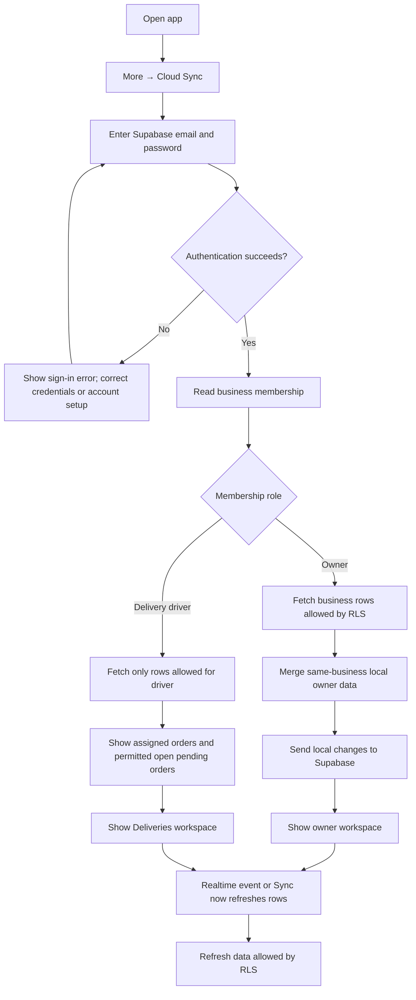
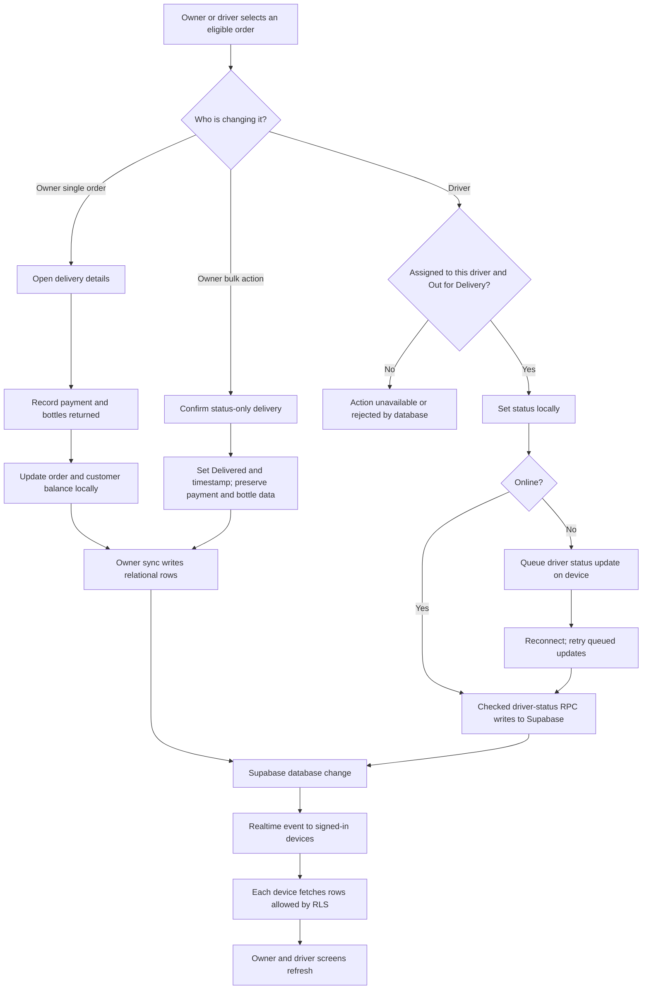

# A2D Elites App User Guide

This guide explains how to use the app as an owner or delivery driver, how
Supabase authentication and sync work, and what to expect while offline.
For initial project setup and SQL details, see
[`SUPABASE_SETUP.md`](./SUPABASE_SETUP.md).

## 1. The short version

- **Supabase Auth** checks the account's email and password.
- **Business membership** decides whether the account is an owner or delivery
  driver. Users do not choose their cloud role in the app.
- **Row Level Security (RLS)** limits which rows each account can read or
  change, even if a client tries to bypass the screens.
- **Supabase Postgres** is the shared source of truth when the app is online.
- **Capacitor Preferences** keeps a device-local copy. Owner changes sync to
  the cloud; a driver's allowed delivery-status changes sync through a
  permission-checking database function.
- **Realtime** tells signed-in devices to refresh business data after a
  database change. If a device is offline, it catches up after reconnecting.

## 2. First-time setup

Before using cloud mode:

1. Complete the database setup described in
   [`SUPABASE_SETUP.md`](./SUPABASE_SETUP.md), including the relational schema
   and migrations for the project.
2. Set the Supabase Project URL and publishable/anon key in the app's local
   environment, then rebuild/restart the app. Never put a service-role or
   secret key in a browser or mobile app.
3. Create the owner's Supabase Auth account and add an `owner` membership to
   the A2D Elites business.
4. Deploy the `manage-driver-credentials` Supabase Edge Function as documented
   in [`SUPABASE_SETUP.md`](./SUPABASE_SETUP.md).
5. After signing in as the owner, create each driver from
   **More → Cloud Sync → Create delivery account**. The account is confirmed
   immediately; securely share the entered email and password with the driver.
6. If this device already has local records, make a JSON backup before the
   first owner cloud sign-in. The initial owner sync merges local data into the
   business cloud data.

## 3. Sign in and open Cloud Sync

1. Open **More → Cloud Sync**.
2. Enter the account's Supabase email and password, then choose **Sign in**.
3. Wait for the status to say **Your local and cloud data are synced**. If the
   panel reports an error, resolve it before relying on cloud changes.
4. Use **Sync now** to request a refresh manually.
5. Use **Sign out** when finished on a shared device.

The app gets the role from the signed-in account's business membership. An
owner sees the owner app. A driver is directed to **Orders/Deliveries** and has
only the limited **More → Cloud Sync** option.

The old role-picker login screen is not the cloud identity system. In a
Supabase-configured build, Supabase membership—not a local role selection—is
what controls access.

## 4. Owner guide

### Orders

1. Open **Orders**.
2. Use **New** to add an order. Choose its customer, products, quantities,
   delivery date/status, payment details, and (where configured) delivery
   person; save the order.
3. Use the date, delivery-status, payment-status, product, or search filters to
   narrow the list.
4. Use the order actions to edit, delete, mark paid, or view/share a bill.
   Cancellation is handled as an order cancellation rather than deleting the
   customer or business.

**Mark one order delivered:** the owner's single-order delivery action opens
the delivery details flow. Use it when recording the payment collected and
empty bottles returned; the app updates the order and customer balance and
offers the delivery WhatsApp action.

**Mark several orders delivered:** select the checkboxes beside eligible
orders, then choose **Mark Delivered** and confirm. This is a status-only
shortcut: it records a delivery timestamp, but does not change payment,
returned-bottle counts, customer balances, or send an individual WhatsApp
receipt. Already-delivered and cancelled orders cannot be selected.

**Mark several unpaid orders paid:** select eligible orders and use the paid
action in the selection bar. Only orders that are not already paid are changed.

### Customers, products, recurring orders, and reports

- **Customers** shows customer details, order history, and balances. Owners can
  manage customer records.
- **More → Products & Pricing** manages products used when creating orders.
- **More → Recurring Orders** manages standing schedules. When the app opens,
  active recurring orders can generate orders due for that day; avoid creating
  a duplicate manually if the recurring order has already generated it.
- **Dashboard** and **Reports** summarize business activity and offer the
  available exports.

### Backups and imports

Open **More → Import/Export** to export a JSON backup, merge a JSON backup into
current local data, or replace local data. Merge each backup file separately.
Review the confirmation and resulting import message. A merge deduplicates
customers/orders and reports records it cannot link; replace overwrites the
current app data on that device.

For the already completed A2D Elites initial import, unresolved records were
quarantined rather than silently attached to the wrong customer. The original
backup files should be retained separately.

### Manage sign-in credentials

In **More → Cloud Sync**, a signed-in owner can:

- Change their own email and/or password by entering the current password.
  Supabase may require the owner to confirm an email change from a message sent
  to the new address.
- Select a delivery person and set a new email and/or password, then re-enter
  the owner's current password. This requires the Edge Function to be deployed.
  The new driver credentials become active immediately; a driver already
  signed in may remain signed in until their token expires.

Choose a strong password and share a driver's new credentials securely. The
owner should not ask a driver to send their password back.

### View driver locations

Open **More → Driver Locations** to see a map of locations drivers have chosen
to share. The map shows the latest point, accuracy, and update time. A marker
older than five minutes is labeled **STALE**; it is the last known point, not a
live position. Use **Refresh** if the map has not updated.

The map displays only the latest shared point for each driver. It does not show
or save a delivery route history.

## 5. Delivery driver guide

1. Sign in from **More → Cloud Sync** with the Auth account provisioned for
   you. Do not select or use another person's identity.
2. Open **Orders/Deliveries**. The initial list shows only orders assigned to
   you for today's delivery date. Use **All time** to view your past assigned
   orders; unassigned orders and orders assigned to another driver stay hidden.
3. For an order assigned to you, mark it **Out for Delivery**, then tap
   **Delivered** when the delivery is complete. Confirm the returned bottle
   count in the delivery modal. For an assigned order with an outstanding
   balance, tap **Collect payment**, enter the amount received on this visit,
   and tap **Record**. Partial amounts are added to the existing paid total;
   the app will not accept an amount greater than the balance due.
4. To complete several eligible deliveries, select checkboxes beside your
   assigned orders already **Out for Delivery**, tap **Mark Delivered**, and
   confirm each delivery and its bottle-return count in turn.
5. Check the Cloud Sync status. When online, changes sync to the database and
   the owner's screen refreshes. If offline, queued driver status, delivery,
   and payment changes are sent when connectivity returns.

The database checks driver identity, business membership, order assignment,
order balance, and allowed status transition. A visible order is not permission
to change another driver's order.

### Assign orders and name drivers

Owners can assign an individual order in its **Assigned delivery driver**
field, choosing a driver, **Owner (you)**, or **Unassigned**. To assign several
at once, select the active orders in **Orders**, choose a driver or **Assign to
owner (you)** in the bulk action bar, and tap **Assign**. Completed and
cancelled orders are not eligible.

Driver names are taken from `profiles.display_name`. For an existing account
with no display name, an owner can set one in Supabase SQL Editor:

```sql
update public.profiles
set display_name = 'Driver name'
where id = 'DRIVER_AUTH_USER_UUID';
```

The app uses the configured name in the header and driver selectors; before a
name is configured, the driver's email prefix is shown on their own account.

### Share location during a shift

1. Open **More → Shift Location Sharing**.
2. Read the sharing notice and check the consent box, then tap **Start Shift
   Location Sharing**. Android asks for location permission and notification
   permission; allow both so its persistent tracking notification can be shown.
3. Keep sharing on only for the active delivery shift. On Android, the app
   sends a point when you move roughly 50 metres. Poor fixes (over 100 metres
   accuracy) are skipped. The owner sees the latest accepted point and update
   time, not continuous animation.
4. Tap **Stop Sharing** at the end of the shift. The app removes the latest
   location from Supabase. If the device is offline, it stops tracking locally
   and clears the cloud point after reconnecting.

Android background delivery is best-effort. Battery restrictions, GPS/network
coverage, force-stopping the app, or an expired sign-in can interrupt updates.
The app's location page shows errors, and the owner's map marks points stale
after five minutes. In a browser, location is shared only while the app remains
open. This repository does not yet include an iOS native project configured
for background location.

## 6. Flowchart: from sign-in to data on screen



## 7. Flowchart: delivery update and multi-device sync



## 8. What sync does (and does not do)

### Owner

- On a successful cloud load, the owner receives the business's relational
  customers, products, orders/items, and recurring orders.
- On the first owner sync, this device's local data is merged with the
  business data, then changes are uploaded.
- Later owner changes are saved locally and sent to Supabase when online.
- Cloud changes on another device cause a refresh through Realtime; **Sync now**
  can request a refresh if needed.

### Delivery driver

- The driver fetches data from the cloud within RLS restrictions. Driver
  changes use the checked status-update RPC; they do not have owner write
  privileges.
- Location sharing is separate from order status sync. It is an opt-in shift
  action, uses a location foreground service on Android, and stores only the
  current point in `driver_locations`.
- Offline delivery-status changes are queued on that device and retried after
  reconnection. Other devices cannot see an offline change until it reaches
  Supabase.
- Location points are not queued offline. A stopped shift's pending cloud clear
  is retried when the device reconnects.
- A new driver's first use requires a working connection so the app can verify
  the Auth session and business membership.

### Offline and conflicts

- The app can show previously cached data offline, but full offline sign-in
  after a cold start is not supported.
- A status update queued offline can fail later if the order was changed,
  cancelled, reassigned, or is no longer in an allowed transition. Check the
  Cloud Sync error/status and contact the owner rather than assuming it synced.
- Realtime is a refresh notification; it is not a permanent event history.
  Devices must be signed in, online, and have the Realtime publication enabled.
- Clearing browser site data can remove that browser's local copy. Keep regular
  JSON backups and do not treat a device cache as the only copy of business
  records.

## 9. Troubleshooting

| What you see | What to check |
|---|---|
| “This account has no business role yet” | Ask the administrator to create the account's correct membership for A2D Elites. |
| Sign-in fails | Verify the email/password, Auth user status, email confirmation settings, and internet connection. |
| Cloud Sync says error | Read the error shown in **More → Cloud Sync**; check project URL/key, database migrations, role membership, and connection. |
| Driver cannot change an order | Confirm the driver is signed in to the correct account, the order is assigned to that Auth user, and the status transition is allowed. |
| Driver credential form fails | Confirm the Edge Function is deployed and that the target driver belongs only to this business. |
| Another device has stale data | Confirm it is online and signed in, tap **Sync now**, and verify the Realtime publication migration was applied. |
| Driver location is missing or stale | Confirm the driver started sharing, allowed location and notification permissions, is signed in, and has GPS/network access. Check Android battery restrictions and the update time on the map. |
| Import skips orders | Check the import message and quarantine report; fix customer links in the source backup rather than guessing a customer. |

## 10. Permissions at a glance

| Task | Owner | Delivery driver |
|---|---:|---:|
| View all business orders and customers | Yes | No |
| Create, edit, cancel orders | Yes | No |
| Assign delivery person | Yes | No |
| Assign orders to self | Yes | No |
| View assigned orders | Yes | Yes |
| View unassigned pending orders | Yes | May view, cannot update |
| Start/complete assigned delivery | Yes | Yes, allowed status transitions only |
| View drivers' shared latest locations | Yes | No |
| Share own location during a shift | No | Yes, explicitly started/stopped |
| Manage products, recurring orders, reports, imports | Yes | No |
| Change own email/password in the app | Yes | No |
| Set a delivery person's credentials | Yes | No |
| Create delivery accounts | Yes | No |
| Manage business settings | Yes | No |

For exact database policies and account provisioning, see
[`SUPABASE_SETUP.md`](./SUPABASE_SETUP.md).
